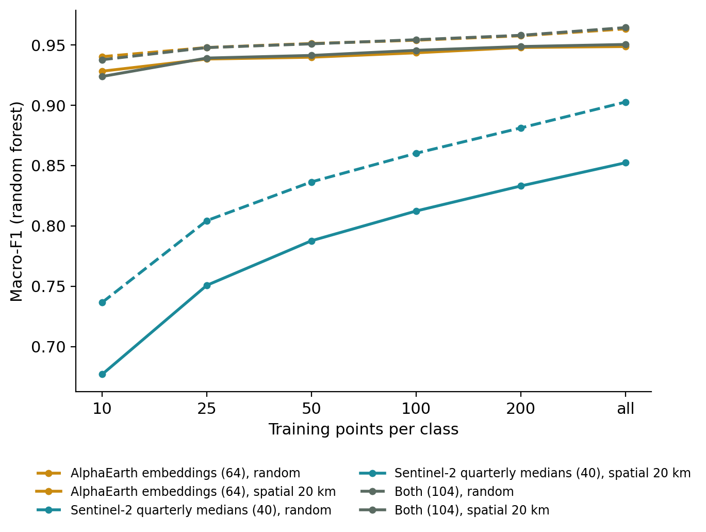

# Satellite Embeddings Under Spatial Validation

Do Google's AlphaEarth Foundations satellite embeddings still beat Sentinel-2 composites when the test area is somewhere the model has not seen? A preregistered crop-mapping test in California's southern San Joaquin Valley, with random and spatial-block cross-validation and learning curves from 10 labels per crop.

**Live dashboard: https://linaq11.github.io/satellite-embeddings-spatial-cv/**


## Results

Macro-F1 of a random forest with spatial validation in 20 km blocks:

| Labels per crop | AlphaEarth embeddings (64) | Sentinel-2 quarterly medians (40) | Difference, 95% interval |
|---|---|---|---|
| 10 | 0.928 | 0.677 | +0.25 (0.24 to 0.26) |
| 25 | 0.938 | 0.751 | +0.19 (0.18 to 0.20) |
| all (about 480) | 0.949 | 0.852 | +0.10 |

With 10 labels per crop the embeddings already reach a macro-F1 that Sentinel-2 does not reach with all of them. Adding Sentinel-2 to the embeddings changes almost nothing (0.950 with all labels).

**Random validation inflates the score, and much more for Sentinel-2.** With all labels, random 5-fold validation gives a higher macro-F1 than spatial validation by 0.050 for Sentinel-2 but only 0.015 for the embeddings (random forest; 95% intervals over folds of 0.022 to 0.077 and −0.002 to 0.032). The embeddings lose less when the test area is new.

| Block size | AlphaEarth, 25 labels | Sentinel-2, 25 labels | AlphaEarth, all | Sentinel-2, all |
|---|---|---|---|---|
| 10 km | 0.944 | 0.790 | 0.955 | 0.876 |
| 20 km | 0.938 | 0.751 | 0.949 | 0.852 |
| 40 km | 0.910 | 0.700 | 0.925 | 0.801 |

Larger blocks lower both methods and widen the gap between them.



## Preregistered tests

Written down before any sample was drawn ([PREREGISTRATION.md](PREREGISTRATION.md)).

* **H1, embeddings with few labels: holds.** Under spatial validation, with 10 and 25 labels per crop, the random forest on embeddings beats the one on Sentinel-2 by at least 0.05, with 95% intervals well above zero.
* **H2, random validation inflates by at least 0.02 in every case: does not hold.** It holds for Sentinel-2 with both models and for the embeddings with logistic regression; it does not for the embeddings or the combined set with the random forest, where the inflation is about 0.015.

**Deviation, stated openly.** The preregistration did not say over which units the H2 interval is resampled. The analysis script first resampled the 10 draws, which only change the forest's random seed, so its intervals are far too narrow (zero width for logistic regression). The intervals reported above resample the five folds of each validation scheme instead. The H2 verdict is the same either way. Both versions are in `data/summary.json`.

## Data and method

| Item | Value |
|---|---|
| Area | 120.6° W to 118.9° W, 35.8° N to 37.1° N (Fresno, Kings and Tulare counties) |
| Labels | USDA NASS Cropland Data Layer 2023, cultivated cells with confidence of 90 or more |
| Crops | the 8 with most such cells: almonds, pistachios, grapes, fallow/idle cropland, citrus, tomatoes, alfalfa, cotton |
| Sample | 600 points per crop, stratified random at 30 m, 4,800 in total |
| Embeddings | `GOOGLE/SATELLITE_EMBEDDING/V1/ANNUAL`, 2023, 64 bands |
| Sentinel-2 | surface reflectance, cloud-masked with the scene classification, median of each quarter of 2023, 10 bands, 40 features |
| Models | random forest (300 trees) and logistic regression on standardized features, neither tuned |
| Validation | random 5-fold and 5-fold by 20 km blocks (10 and 40 km as checks); 10 random draws of the training set at each size |

## Reproduce

```bash
pip install -e ".[build,test]"
python scripts/sample.py --project <your-earth-engine-project>   # writes data/sample.csv
python scripts/run_experiment.py                                 # about 12 hours on 12 cores
python scripts/analyze.py
python scripts/export_web.py
python -m http.server --directory docs
```

`pytest` checks that random folds are balanced, that every point of a block lands in the same fold (and fails when blocks are ignored), the per-class subsampling and the bootstrap interval.

## Limits

* The labels are the CDL, itself a classification, filtered to confidence of 90 or more. That keeps the easier cells, so every score here is higher than it would be on all fields, and the CDL's own errors are part of the reference.
* Fallow/idle cropland entered as a class because the preregistered rule takes the 8 cultivated codes with most cells; it is not a crop in the same sense as the others.
* One region, one year and two untuned models. The size of the gap may differ elsewhere.
* Spatial folds are uneven in size and composition (from 636 to 1,437 points, at least 10 per crop per fold).

## Credits

Cropland Data Layer: USDA National Agricultural Statistics Service. AlphaEarth Foundations satellite embeddings: Google, through Earth Engine. Sentinel-2: European Space Agency, Copernicus. Basemap: Esri World Imagery. Map: MapLibre GL JS.

Lina María Quintero Fonseca, geographer, MSc student in Geomatics at the Universidad Nacional de Colombia. Code under the MIT License; to cite, use `CITATION.cff`.
