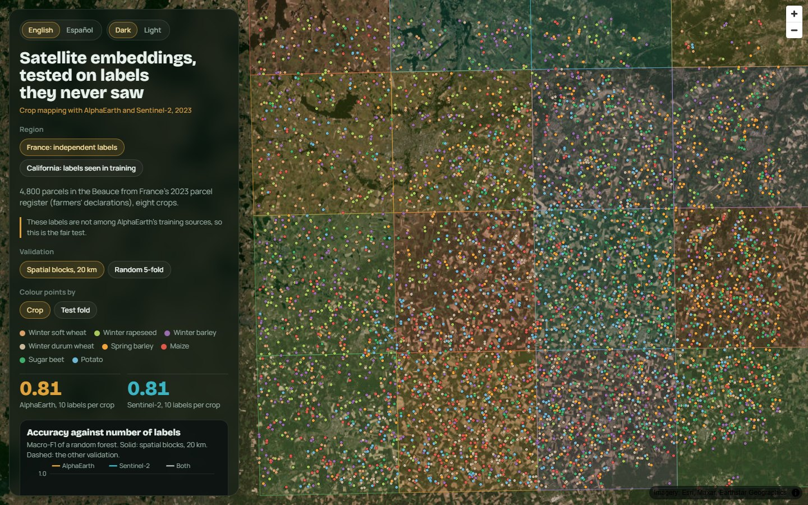
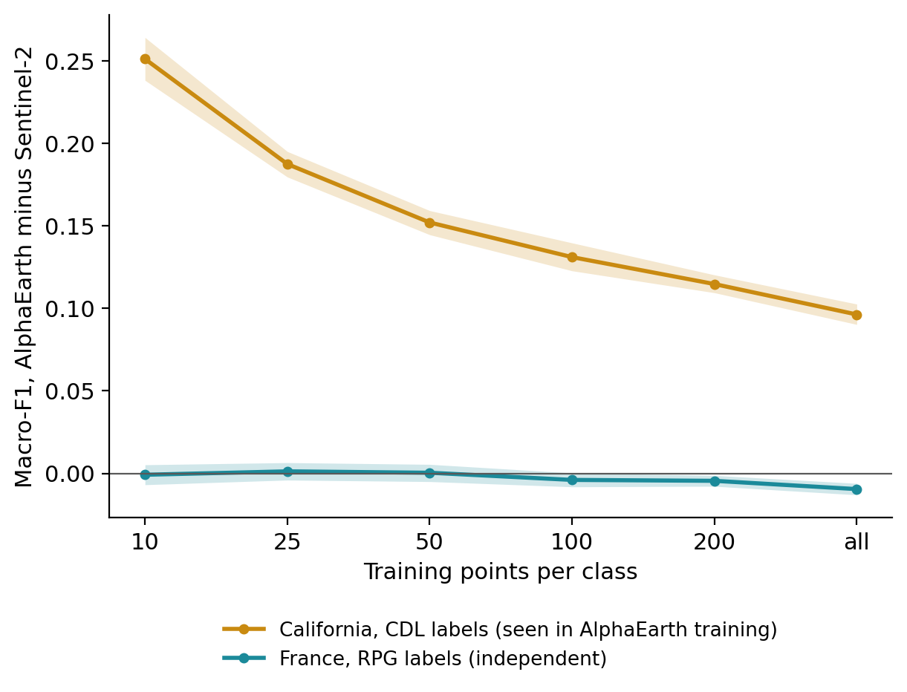

# Satellite Embeddings, Tested on Labels They Never Saw

Google's AlphaEarth Foundations embeddings are often reported to beat raw satellite bands by a wide margin when labels are scarce. This preregistered test checks that claim for crop mapping twice: in California, with labels the embedding model was trained on, and in France, with labels it never saw. With spatial cross-validation, the large advantage in California disappears in France.

**Live dashboard: https://linaq11.github.io/Satellite-embeddings-spatial-validation/**



## Results

Macro-F1 of a random forest, spatial validation in 20 km blocks, 8 crops, 10 random draws per training size:

| | California, CDL labels | France, RPG labels |
|---|---|---|
| Labels seen in AlphaEarth training | yes (v2.1 used the CDL as a target) | no |
| AlphaEarth embeddings, 10 labels per crop | 0.928 | 0.810 |
| Sentinel-2 quarterly medians, 10 labels per crop | 0.677 | 0.811 |
| Difference, 95% interval | +0.25 (0.24 to 0.26) | −0.001 (−0.007 to +0.005) |
| AlphaEarth, all labels | 0.949 | 0.885 |
| Sentinel-2, all labels | 0.852 | 0.894 |
| Both together, all labels | 0.950 | 0.908 |



In California the embeddings lead at every training size. In France they tie with Sentinel-2 up to 100 labels per crop (every 95% interval includes zero) and fall slightly behind with 200 and with all of them (−0.010 with all, 95% interval −0.013 to −0.006). Combining both feature sets is the best option in France (0.908 with all labels). With logistic regression instead of a random forest the embeddings keep a small lead in France at 10 labels per crop (0.806 against 0.769).

**What this does and does not show.** The two regions differ in more than the labels: California's classes include orchards, vineyards and fallow land, France's are annual field crops, and the climate and cloud cover differ. The contrast is consistent with the embeddings having learned the Cropland Data Layer during training, but it does not isolate that cause. Doing so would need independent labels in California, or CDL labels in a region outside the embedding model's training sample.

### Random against spatial validation

| Inflation (random minus spatial), all labels, random forest | California | France |
|---|---|---|
| AlphaEarth | +0.015 (−0.002 to 0.032) | +0.013 (0.000 to 0.025) |
| Sentinel-2 | +0.050 (0.022 to 0.077) | +0.005 (−0.003 to 0.013) |

Intervals resample the five folds of each scheme. Random validation inflated Sentinel-2 clearly only in California, where crops form large single-crop areas (orchards in the east, cotton and fallow land in the south-west) that a random split leaks across.

## Preregistered tests

Written before any data were drawn ([PREREGISTRATION.md](PREREGISTRATION.md)); Part 2 was added, dated, before any French label was downloaded.

| Hypothesis | California | France |
|---|---|---|
| H1: with 10 and 25 labels per crop and spatial validation, embeddings beat Sentinel-2 by at least 0.05 | holds | does not hold |
| H2: random validation inflates macro-F1 by at least 0.02 in every case | does not hold | does not hold |

**Deviations, stated openly.**

1. *H2 intervals.* The preregistration did not say over which units the H2 interval is resampled. The analysis script first resampled the 10 draws, which only change the forest's random seed, so those intervals are too narrow. The tables above resample folds instead; the verdicts are the same. Both versions are in `data/summary.json` and `data/summary_fr.json`.
2. *40 km blocks in France.* The French box (about 73 by 67 km) holds only four 40 km blocks, so that sensitivity check runs on four folds instead of five.
3. *Part 2 exists because of Part 1.* It was added after Part 1 had been run and its results seen, once the dataset page showed that the embedding model had used the CDL in training.

## Data and method

| Item | California (Part 1) | France (Part 2) |
|---|---|---|
| Area | 120.6° W to 118.9° W, 35.8° N to 37.1° N | the Beauce, 1.2° E to 2.2° E, 48.0° N to 48.6° N |
| Labels | USDA NASS Cropland Data Layer 2023, confidence of 90 or more | Registre Parcellaire Graphique 2023 (farmers' declarations), parcels of 1 ha or more |
| Classes | almonds, pistachios, grapes, fallow/idle cropland, citrus, tomatoes, alfalfa, cotton | winter soft wheat, winter rapeseed, winter barley, winter durum wheat, spring barley, maize, sugar beet, potato |
| Sample | 600 points per class (stratified random at 30 m) | 600 parcels per class, one interior point each |
| Projection for blocks | WGS 84 / UTM 11N | RGF93 / Lambert-93 |

Common to both: AlphaEarth embeddings for 2023 (`GOOGLE/SATELLITE_EMBEDDING/V1/ANNUAL`, 64 bands); Sentinel-2 surface reflectance cloud-masked with the scene classification, median of each quarter of 2023 for 10 bands (40 features); random forest (300 trees) and logistic regression, neither tuned; random 5-fold and 20 km block 5-fold validation, with 10 and 40 km blocks as checks; training sizes of 10, 25, 50, 100, 200 and all points per class, 10 draws each.

## Reproduce

```bash
pip install -e ".[build,test]"
python scripts/sample.py --project <your-earth-engine-project>          # Part 1 sample
python scripts/download_rpg.py                                           # Part 2 labels, about 71 MB from the IGN WFS
python scripts/sample_fr.py --project <your-earth-engine-project>       # Part 2 sample
python scripts/run_experiment.py                                         # Part 1
python scripts/run_experiment.py --sample sample_fr.csv --crs 2154 --tag _fr
python scripts/analyze.py && python scripts/analyze.py --tag _fr && python scripts/compare_parts.py
python scripts/export_web.py && python -m http.server --directory docs
```

`pytest` checks balanced random folds, that every point of a block shares a fold (and fails when blocks are ignored), the per-class subsampling and the bootstrap interval.

## Limits

* The CDL is itself a classification, filtered here to confidence of 90 or more, which keeps easier cells. The RPG records what farmers declared, which is closer to ground truth but not checked in the field.
* One region and one year per part and two untuned models.
* Points are one per parcel in France and one per 30 m cell in California, so nearby California points can share a field.

## Credits

The AlphaEarth Foundations Satellite Embedding dataset is produced by Google and Google DeepMind (CC BY 4.0). Cropland Data Layer: USDA National Agricultural Statistics Service. Registre Parcellaire Graphique: IGN and Agence de Services et de Paiement, Licence Ouverte 2.0. Sentinel-2: ESA, Copernicus. Basemap: Esri World Imagery. Map: MapLibre GL JS.

Lina María Quintero Fonseca, geographer, MSc student in Geomatics at the Universidad Nacional de Colombia. Code under the MIT License; to cite, use `CITATION.cff`.
